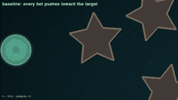
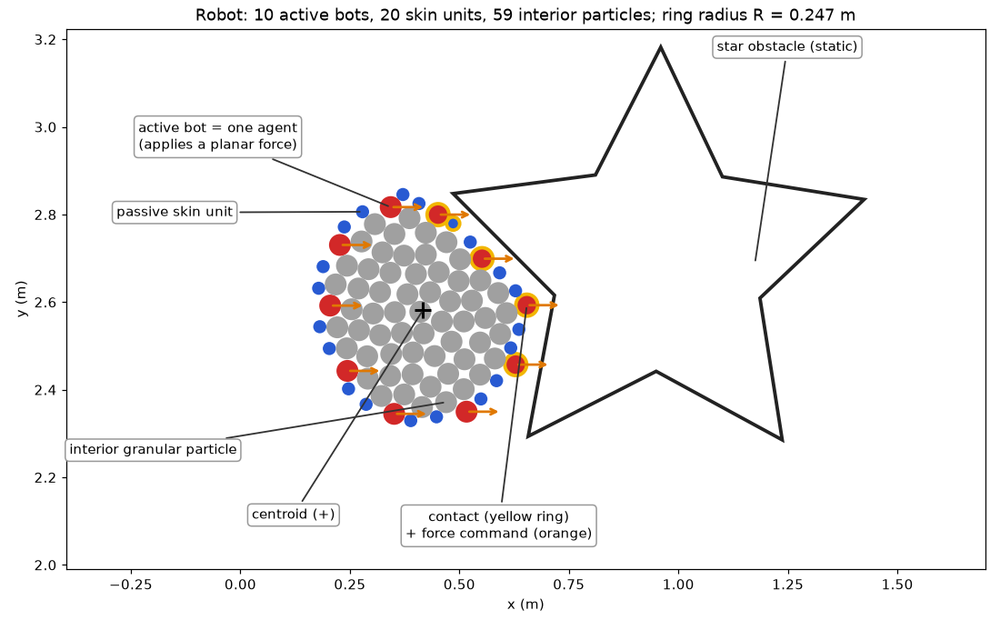
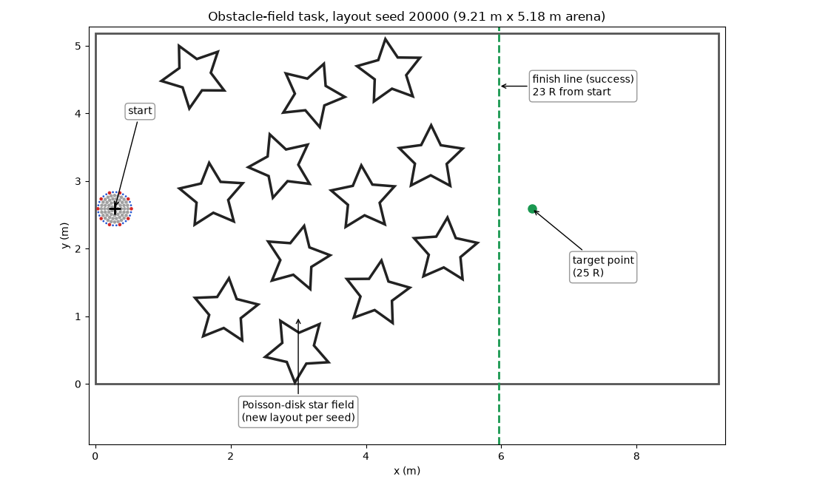
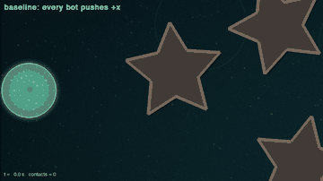
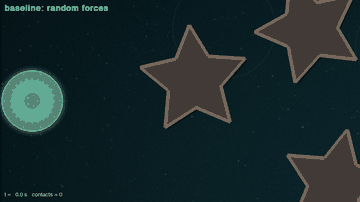
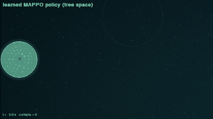
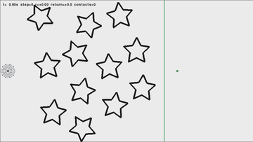
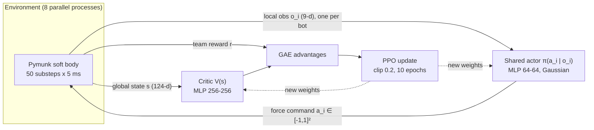
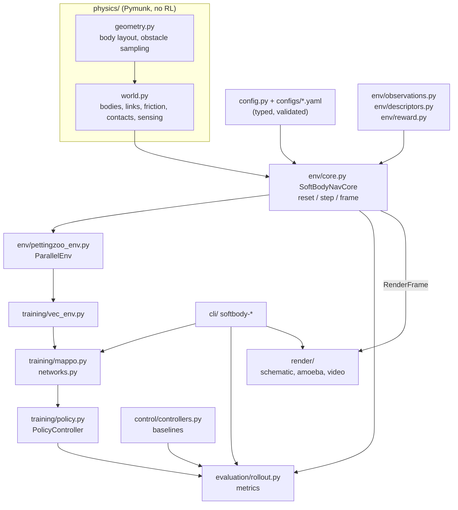

# Multi-Agent Reinforcement Learning for a Granular Soft Robot

A research codebase for learning **decentralised control of a soft, granular-jammed robot**: a closed ring of
actuated "bots" and passive skin units that holds loose interior particles. Each bot is an independent RL agent that
chooses a planar force. Together they must move and deform the shared body through a randomised obstacle field to a
target.

<p align="center">
  <br>
  <em>Amoeba-style rendering of a real simulation (scripted target-seeking controller, test layout 20000).
  The styling is cosmetic; see <a href="#watch-it">Watch it</a> for the plain physics view.</em>
</p>

The package (`softbody_marl`) gives you:
- a headless, seeded Pymunk 7 simulation in SI units;
- a PettingZoo `ParallelEnv`;
- global shape and contact descriptors for centralised critics;
- configurable rewards, with every component logged;
- parameter-shared **MAPPO / IPPO** in PyTorch;
- YAML-defined experiments and ablations;
- evaluation tooling and an optional pygame viewer.

> Status: environment, baselines and the training pipeline are complete and tested. Learned policies have not yet
> beaten the scripted baselines (see [Current results](#current-results)). Large-scale training and ablations are next.

---

## Contents
- [The robot](#the-robot)
- [The task](#the-task)
- [Watch it](#watch-it)
- [Multi-agent formulation](#multi-agent-formulation)
- [Reward](#reward)
- [Training paradigm](#training-paradigm)
- [Quick start](#quick-start)
- [Experiments and configuration](#experiments-and-configuration)
- [Outputs and reproducibility](#outputs-and-reproducibility)
- [Current results](#current-results)
- [Repository layout](#repository-layout)
- [Documentation](#documentation)

---

## The robot



| Component | Default | Role |
|---|---|---|
| Active bots | 10 × (r = 0.025 m, m = 0.15 kg) | Actuated: each applies a planar force at its centre |
| Passive skin | 2 units between neighbouring bots (r = 0.015 m) | Close the membrane |
| Interior particles | 59 × (r = 0.025 m, m = 0.5 g) | Granular "sand" that gives the body volume |
| Neighbour links | Spring (rest length 0) + hard max gap of 0.875 × particle diameter | The gap stays smaller than a particle, so sand cannot escape |
| Ground | Planar Coulomb-like friction (μ = 0.2) on every body | Top-down plane, no gravity |

The ring radius is R ≈ 0.247 m. The body is soft: it squeezes, stretches and wraps around obstacles. It is not a rigid
formation. All quantities are SI.

**`sim.force_scale` (default 1/150).** The original code mixed pixel and SI units, so its springs, actuation and ground
friction were 1/150 of their nominal values. Damping was not affected. `force_scale` reproduces that *effective*
behaviour explicitly. Setting it to `1.0` (`configs/env/nominal_si.yaml`) gives the nominal SI forces, which are
numerically unstable at the default timestep. See [docs/environment_spec.md](docs/environment_spec.md) for the
derivation and measurements.

## The task



**Obstacle-field navigation.**
- **Start and target:** the body starts near the left wall. The target is 25 R (6.17 m) straight ahead.
- **Obstacles:** hollow 5-point stars (outer radius 2R), placed by Poisson-disk sampling (minimum spacing 4.5 R), randomly rotated. Obstacles that would overlap the start pose are rejected.
- **Layouts:** each reset seed defines a new layout.
- **Timing:** each control step holds the action for 50 physics substeps of 5 ms, so one step is 0.25 s. Episodes last up to 60 s (240 steps).

| Outcome | Condition | Type |
|---|---|---|
| success | centroid crosses the finish line at x = target_x − 2 R (23 R from the start) | terminal |
| failure | non-finite state, any body faster than 5 m/s, or a link stretched > 5 % beyond its limit | terminal |
| timeout | 60 s elapsed | truncation |

The core class `SoftBodyNavCore` (`reset(seed, obstacles=...)`, `step(actions)`, `frame()`) has no RL dependency.
Hand-made levels can be passed as `obstacles`. A renderer or a future human-input game loop can drive the same core.

## Watch it

Each clip is one real episode, recorded with `softbody-record` / [scripts/make_media.py](scripts/make_media.py).
All use the same test layout (seed 20000) except the free-space policy. They are illustrations, not performance
evidence; see [Current results](#current-results) for statistics. Video runs at 5× real time (one frame per 0.25 s
control step at 20 fps). Click a preview for the full MP4.

| | |
|---|---|
| [](docs/media/push_x_amoeba.mp4)<br>**Push +x:** every bot pushes right. The body wraps around and gets stuck on a star (60 s, 38 % progress). | [](docs/media/target_seek_amoeba.mp4)<br>**Target-seek:** every bot pushes toward the target. It gets further on this layout (60 s, 53 % progress). |
| [](docs/media/random_amoeba.mp4)<br>**Random forces:** shows how the soft body jiggles and deforms without coordination (20 s). | [](docs/media/learned_free_space_amoeba.mp4)<br>**Learned MAPPO policy (free space):** reaches the finish line in 18.75 s (constant push: 19.25 s). |
| [](docs/media/push_x_schematic.mp4)<br>**Schematic view (push +x):** red = active bot, blue = skin, grey = interior, yellow ring = contact, orange = force. | **Amoeba style legend:** glowing membrane = spline through the membrane units; bright beads = active bots, brighter when pushing harder; warm sparks = contact; granules = interior particles; nucleus and trail are decorative. |

Record your own: `softbody-record --checkpoint <best.pt> --style amoeba --view 3.2 1.8 --ppm 300 --out my.mp4`.

## Multi-agent formulation

Agents `bot_0 … bot_9` act simultaneously, share one team reward, and terminate together.

**Action** (per agent): `Box(-1, 1, (2,))`, a world-frame force command. Out-of-range values are clipped and the
clipped fraction is logged. The applied force is `action × 2 N × force_scale`.

**Local observation** (per agent, 9 dims by default; actors see only this):

| Dims | Quantity |
|---|---|
| 2 | target − body centroid (normalised by the target distance) |
| 2 | centroid velocity (equal to the mean bot velocity) |
| 2 | own position relative to the centroid (/ R) |
| 1 | binary environment-contact flag, from physics collision callbacks |
| 2 | contact direction: unit vector from the touched obstacle/wall toward the bot, zeros when free (`contact_normal`, default on) |
| K | range sensing: free distance along K world-frame rays from the bot surface, / ray length (`range_sensors`, default off; K = 8, length 1 R) |

The two sensing blocks are independent booleans in `env.observation`, so each can be studied alone, together, or not at
all (`mappo_no_sensing.yaml` is the legacy-style binary-contact-only observation). Other optional additions: absolute
position, a role encoding (`one_hot` / `ring_angle`), and any of the global descriptors below.

**Global state** `env.state()` (124 dims by default; for critics and evaluation): all bot relative positions and
velocities, contact flags and any enabled sensing, an 8-sector radial shape descriptor, Fourier shape magnitudes
(invariant to translation and rotation; handles concave and folded shapes), a ring-ordered contact map, and the
episode time fraction.

## Reward

The shared team reward is a sum of components, each logged separately in `info["reward_components"]` and in training
metrics:

| Component | Default | Notes |
|---|---|---|
| `progress` | 2000 × (distance reduction in m), negatives clipped to 0 | Legacy shaping. Rewards oscillation; judge by task success, not return |
| `success` | +5 | Terminal bonus for crossing the finish line (legacy value) |
| `timeout` / `failure` | −10 / −10 | |
| `contact` | weight 0 (off) | −w × fraction of bots touching obstacles (optionally walls) |
| `control_effort` | 0 (off) | Penalty on mean squared action |
| `deformation` | 0 (off) | Penalty on the absolute deviation of the area ratio from 1 |

**Scale caveat.** Straight pushing earns about 23 reward per step. A contact weight of 1 is therefore about 1 % of the
signal. The contact-penalty ablation uses 10 as a starting hypothesis; sweep it.

## Training paradigm

**Centralised training, decentralised execution** with PPO (`src/softbody_marl/training/`):



At execution time only the actor is used, and each bot sees only its own observation.

- **Actor:** one MLP shared by all bots by default (`share_parameters: false` gives a separate actor per bot). It
  outputs a diagonal Gaussian with a learned, state-independent standard deviation. At evaluation time the mean action
  is used.
- **Critic** (`train.critic.input`):
  - `state`: MAPPO, centralised V(s);
  - `state_and_local`: agent-specific V(s, o_i);
  - `local`: IPPO, V(o_i).
- **PPO details:**
  - GAE;
  - clipped surrogate objective;
  - optional value clipping and KL early stopping;
  - running normalisation of observations, critic state and value targets (stored in checkpoints);
  - time-limit truncation bootstrapped from V(final observation);
  - optional frame stacking for actor and critic.
- **Parallelism:** N environments run in spawn-based subprocesses (or in-process with `sync`). The simulator is
  CPU-bound; the networks are small, so the CPU is also the fastest device for them.
- **Seeds:** obstacle layouts for **train** [0, 10000), **validation** [10000, 10020) and **test** [20000, 20100) are
  disjoint, and the config rejects overlap. Validation selects `best.pt`. The test set is evaluated once, at the end,
  on `best.pt`.

## Quick start

```bash
python3.13 -m venv .venv && source .venv/bin/activate
pip install -e ".[all]"            # core + pygame-ce + torch + matplotlib + pytest
python -m pytest                   # 48 tests: physics, env, PettingZoo API, rendering, training

softbody-view --controller target_seek --seed 0                    # watch a scripted controller
softbody-rollout --controller push_x --seeds 10000 10020           # evaluate a baseline
softbody-benchmark --steps 400 --workers 1 2 4 8                   # measure throughput

softbody-train --config configs/train/smoke.yaml                   # seconds-long pipeline check
caffeinate -i softbody-train --config configs/train/mappo.yaml     # reference run (macOS: prevent sleep)
softbody-plot runs/train/<run_a> runs/train/<run_b>                # learning curves
softbody-sweep --configs configs/train/mappo.yaml configs/train/ippo.yaml --seeds 0 1 2 --name critic
softbody-sweep --configs configs/train/mappo.yaml --grid "env.reward.contact_penalty_weight=1,10,50" --name contact
softbody-compare runs/sweeps/critic                                # test metrics, mean ± std over seeds
zsh scripts/local_campaign.sh 1 2                                  # staged multi-day local campaign (see script)
softbody-rollout --checkpoint runs/train/<run>/checkpoints/best.pt --seeds 20000 20100
softbody-view --checkpoint runs/train/<run>/checkpoints/best.pt --seed 20000
softbody-train --resume runs/train/<run>                           # continue an interrupted run
```

Python API:

```python
from softbody_marl.config import load_env_config
from softbody_marl.env.pettingzoo_env import SoftBodyParallelEnv

env = SoftBodyParallelEnv(load_env_config("configs/env/default.yaml"))
obs, infos = env.reset(seed=0)
obs, rewards, terms, truncs, infos = env.step({a: env.action_space(a).sample() for a in env.agents})
critic_input = env.state()
```

## Experiments and configuration

Every physical, reward, observation, architecture and optimisation parameter is in YAML:
- Files inherit with `base:`.
- Unknown keys are errors.
- Any value can be overridden from the command line, e.g.
  `--set env.reward.contact_penalty_weight=50 train.actor.network.hidden_sizes=[128,128]`.

An experiment file has an `env:` section and a `train:` section. [configs/train/mappo.yaml](configs/train/mappo.yaml)
lists every value explicitly.

| Environment configs (`configs/env/`) | |
|---|---|
| `default.yaml` | obstacle field, legacy-effective dynamics |
| `no_obstacles.yaml` | free space (sanity checks, curricula) |
| `contact_penalty.yaml` | contact penalty enabled |
| `range_sensing.yaml` | range rays instead of contact direction |
| `nominal_si.yaml` | `force_scale = 1` |

| Training configs (`configs/train/`) | Studies |
|---|---|
| `mappo.yaml` | reference: shared actor, centralised V(s) |
| `ippo.yaml` | local critic V(o_i) |
| `mappo_agent_specific_critic.yaml` | critic V(s, o_i) |
| `mappo_contact_penalty.yaml` | contact penalty (w = 10) vs none |
| `mappo_framestack4.yaml` | 0.75 s observation history |
| `mappo_role_onehot.yaml` | ring-position encoding for actors |
| `mappo_no_sharing.yaml` | separate actor per bot |
| `mappo_no_obstacles.yaml` | free-space learnability check (300k steps) |
| `mappo_no_sensing.yaml` | binary contact flag only |
| `mappo_range_sensing.yaml` | range rays instead of contact direction |
| `smoke.yaml` | pipeline smoke test (not an experiment) |

For multi-seed studies, use `softbody-sweep`. It runs every config × seed sequentially under
`runs/sweeps/<name>/` and writes `comparison.md` with test metrics as mean ± std across seeds.

## Outputs and reproducibility

Each run creates `runs/<group>/<timestamp>_<name>/`:

| File | Content |
|---|---|
| `config.yaml` | fully resolved configuration |
| `metadata.json` | package versions, git commit and dirty flag, platform, argv; appended on resume |
| `metrics.jsonl` | one record per update (`type: train`) and per validation (`type: validation`) |
| `run.log` | human-readable log |
| `checkpoints/` | `latest.pt`, `best.pt`, periodic `update_*.pt`: weights, optimiser, normalisers, RNG states, seed counters |
| `test_summary.json`, `test_episodes.json` | held-out test results |

Training metrics include:
- losses, KL, clip fraction, explained variance and action std;
- per-update throughput;
- per-episode return, every reward component, success / failure rates and progress;
- contact statistics and deformation (area ratio, link stretch).

Evaluation episodes also report path efficiency, circularity and interior escapes. Trajectories can be saved as
`.npz`.

## Current results

All numbers were measured on an Apple M2 (8 cores) with Python 3.13 and are reproducible with the commands above.

**Throughput:**
- About 15.6k physics substeps/s under contact load (≈24.6k with the body at rest).
- 279 environment steps/s in one process (≈70× real time).
- 1,329 steps/s aggregate with 8 processes.
- About 900 steps/s during training with 8 environments.
- About 90 % of step time is the Pymunk solver. Observations, descriptors and reward take about 10 %, so Python-side
  optimisation has little headroom.

**Obstacle field, 100 held-out test layouts (seeds 20000–20099):**

| Controller | Success (finish line) | Progress | Failures | Steps with obstacle contact |
|---|---|---|---|---|
| push +x | 19 % | 0.47 ± 0.26 | 5 % | 78 % |
| target-seek | 20 % | 0.48 ± 0.28 | 6 % | 77 % |
| zero | 0 % | 0.00 | 0 % | 0 % |
| MAPPO probe (102k env steps, ≈5 % of budget, contact-flag-only observation) | 10 % | 0.41 ± 0.24 | 1 % | 72 % |

In free space (`mappo_no_obstacles.yaml`, 300k steps, 9-d observation), MAPPO reaches the finish line in 100 % of test
episodes in 18.75 s, slightly faster than constant pushing (19.25 s).

The short MAPPO probe does not yet beat the scripted controllers. Its learning diagnostics were healthy (explained
variance 0.8–0.9, KL ≈ 0.003).

## Repository layout



```
src/softbody_marl/
  config.py              typed env config, YAML loading, overrides
  experiment.py          run directories, metadata, JSONL metrics, logging
  physics/               layout geometry, obstacle sampling, Pymunk world (no RL logic)
  env/                   core episode logic, observations, descriptors, reward, PettingZoo wrapper
  control/               Controller protocol and scripted baselines
  training/              train config, vectorised envs, networks, MAPPO trainer, policy loading
  evaluation/            rollouts, task metrics, summaries
  render/                schematic + amoeba renderers, MP4/GIF recording (consume RenderFrame snapshots only)
  cli/                   softbody-{train,sweep,compare,rollout,view,record,benchmark,plot}
configs/env/, configs/train/   experiment definitions
scripts/                       local campaign, README media generation
tests/                         pytest suite
docs/                          environment spec, ADRs, legacy audit, AWS plan, review guide, media/
deprecated/                    legacy thesis code kept for reference only (not imported)
runs/                          experiment outputs (git-ignored)
```

## Documentation

- [docs/environment_spec.md](docs/environment_spec.md): physics parameters, units, observations, state, reward and
  diagnostics.
- [docs/adr/0001-physics-and-marl-stack.md](docs/adr/0001-physics-and-marl-stack.md): why Pymunk, PettingZoo and an
  in-repo MAPPO.
- [docs/audit_report.md](docs/audit_report.md): defects found in the legacy code and how they were resolved.
- [deprecated/README.md](deprecated/README.md): legacy tasks (tunnel, object manipulation), reward variants and
  hyperparameters not yet ported.
- [docs/aws_plan.md](docs/aws_plan.md): how to run sweeps on AWS (instance choice, budget, spot/resume, S3 sync).
- [docs/review_guide.md](docs/review_guide.md): guided, ordered code review with takeaways and self-check questions.
- [CHANGELOG.md](CHANGELOG.md): release history.
